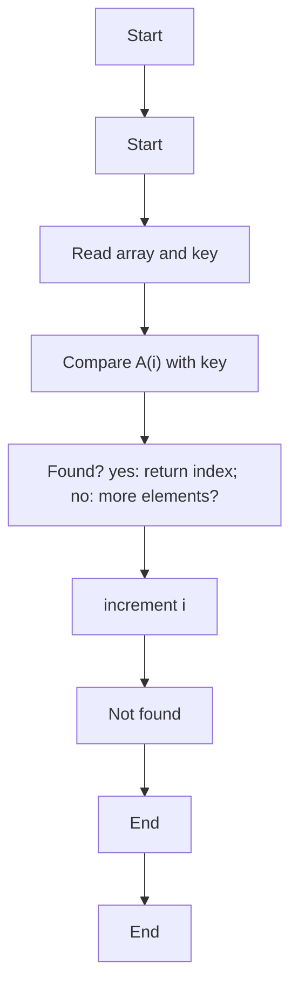
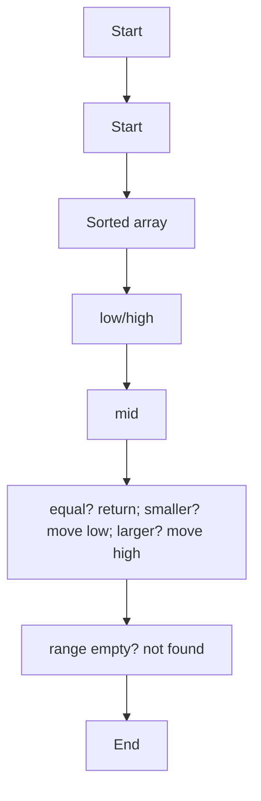
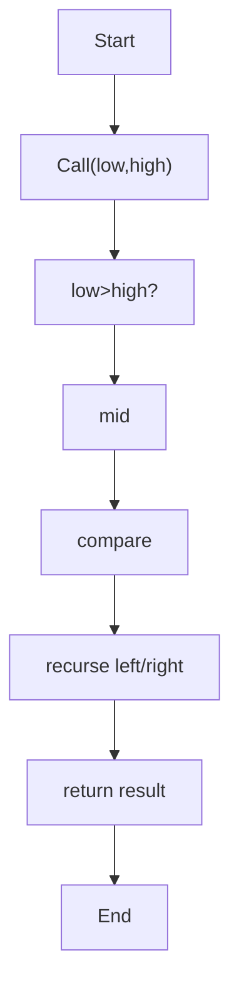
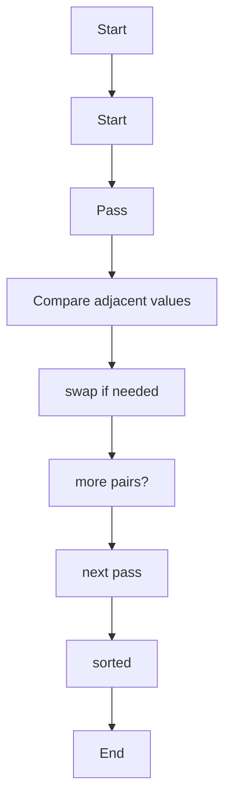
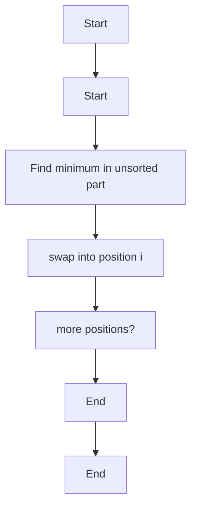
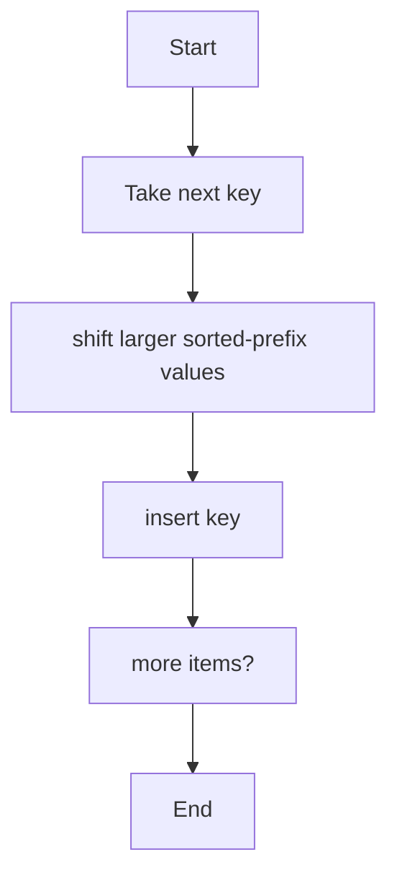

# Unit 1 — Introduction to Algorithms

For each algorithm: concept, pseudocode, algorithm-specific flowchart, and complexity.

## Linear Search

**Concept:** Start at index 0; compare each element with key; stop on match; otherwise report not found.

**Pseudocode:**
```text
for i = 0 to n-1: if A[i] == key return i; return -1
```

**Flowchart:**


**Complexity:**
- Best: `O(1)`
- Average: `O(n)`
- Worst: `O(n)`
- Auxiliary space: `O(1)`

**Representative output:**
```text
Linear Search: key 23 found at index 4
```


## Iterative Binary Search

**Concept:** Repeatedly inspect the middle element of a sorted array and discard half of the remaining range.

**Pseudocode:**
```text
low=0, high=n-1; while low<=high: mid=(low+high)/2; if A[mid]==key return mid; if A[mid]<key low=mid+1 else high=mid-1; return -1
```

**Flowchart:**


**Complexity:**
- Best: `O(1)`
- Average: `O(log n)`
- Worst: `O(log n)`
- Auxiliary space: `O(1)`

**Representative output:**
```text
Binary Search: key 23 found at index 5
```


## Recursive Binary Search

**Concept:** Binary search implemented by recursively calling the search on the left or right half.

**Pseudocode:**
```text
if low>high return -1; mid=(low+high)/2; compare key; recurse into matching half
```

**Flowchart:**


**Complexity:**
- Best: `O(1)`
- Average: `O(log n)`
- Worst: `O(log n)`
- Auxiliary space: `O(log n)`

**Representative output:**
```text
Recursive Binary Search: key 23 found at index 5
```


## Bubble Sort

**Concept:** Repeatedly swap adjacent out-of-order elements; largest unsorted element moves to the end each pass.

**Pseudocode:**
```text
for i=0..n-2: swapped=false; for j=0..n-i-2: if A[j]>A[j+1] swap; if !swapped break
```

**Flowchart:**


**Complexity:**
- Best: `O(n)`
- Average: `O(n²)`
- Worst: `O(n²)`
- Auxiliary space: `O(1)`

**Representative output:**
```text
Before: [5, 1, 4, 2, 8] | After: [1, 2, 4, 5, 8]
```


## Selection Sort

**Concept:** Select the smallest item from the unsorted suffix and place it at the current position.

**Pseudocode:**
```text
for i=0..n-2: min=i; for j=i+1..n-1 if A[j]<A[min] min=j; swap A[i],A[min]
```

**Flowchart:**


**Complexity:**
- Best: `O(n²)`
- Average: `O(n²)`
- Worst: `O(n²)`
- Auxiliary space: `O(1)`

**Representative output:**
```text
Before: [64, 25, 12, 22, 11] | After: [11, 12, 22, 25, 64]
```


## Insertion Sort

**Concept:** Build a sorted prefix by inserting each next element into its correct position.

**Pseudocode:**
```text
for i=1..n-1: key=A[i]; shift larger prefix values right; place key
```

**Flowchart:**


**Complexity:**
- Best: `O(n)`
- Average: `O(n²)`
- Worst: `O(n²)`
- Auxiliary space: `O(1)`

**Representative output:**
```text
Before: [12, 11, 13, 5, 6] | After: [5, 6, 11, 12, 13]
```

> Note: Output lines and output sheets are representative references, not screenshots captured from live execution of the repository's exact source files.