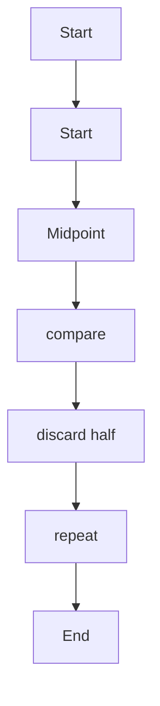
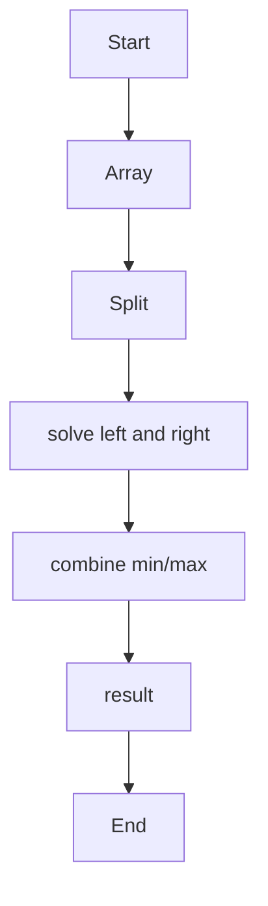
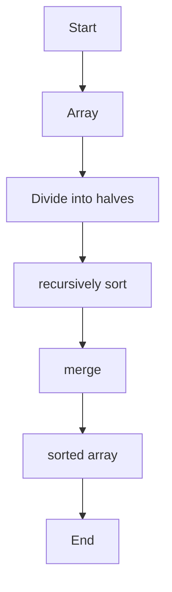
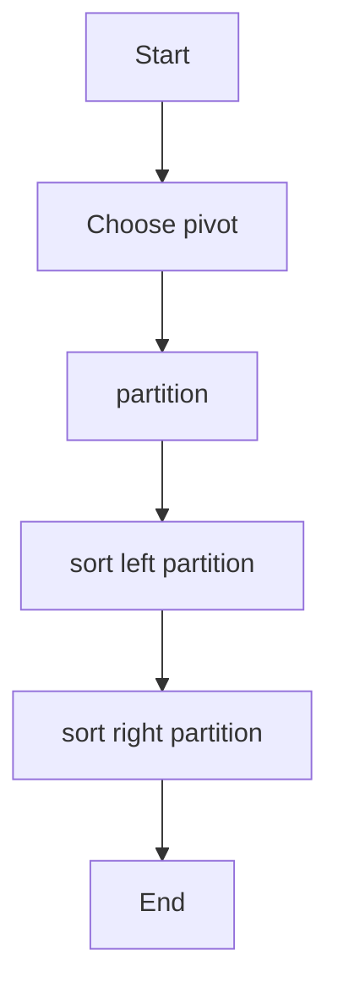
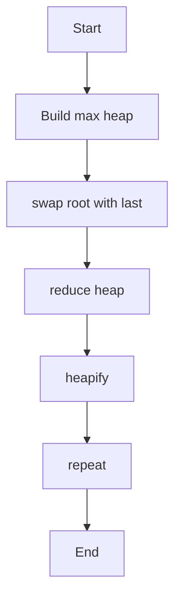
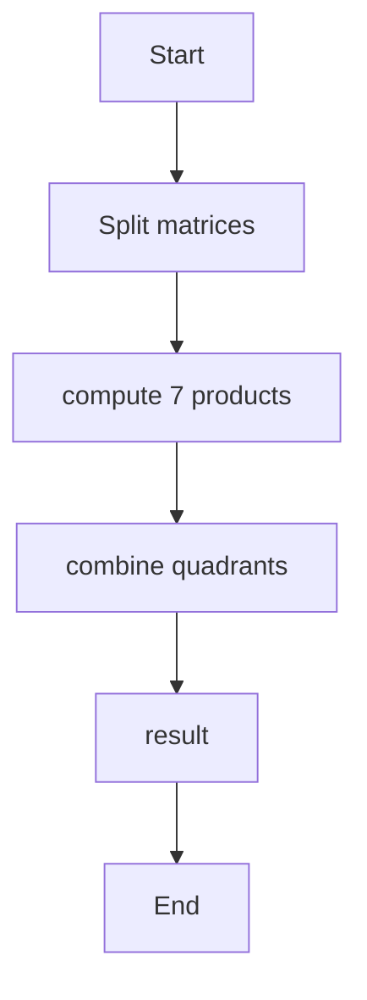

# Unit 2 — Divide and Conquer

For each algorithm: concept, pseudocode, algorithm-specific flowchart, and complexity.

## Binary Search

**Concept:** Divide sorted search range into halves until key is found or interval is empty.

**Pseudocode:**
```text
if low>high return -1; mid; compare; recurse/iterate into one half
```

**Flowchart:**


**Complexity:**
- Best: `O(1)`
- Average: `O(log n)`
- Worst: `O(log n)`
- Auxiliary space: `O(1)`

**Representative output:**
```text
Binary Search result: index 5
```


## Max-Min

**Concept:** Split the array, find min/max in each half, then combine the two pairs.

**Pseudocode:**
```text
if one item return pair; split; L=find(left); R=find(right); return min(L.min,R.min), max(L.max,R.max)
```

**Flowchart:**


**Complexity:**
- Best: `O(n)`
- Average: `O(n)`
- Worst: `O(n)`
- Auxiliary space: `O(log n)`

**Representative output:**
```text
Array [12, 4, 19, -3, 8, 25, 2] | Minimum = -3 | Maximum = 25
```


## Merge Sort

**Concept:** Recursively sort two halves and merge the sorted halves.

**Pseudocode:**
```text
if l<r: m=(l+r)/2; mergeSort(l,m); mergeSort(m+1,r); merge(l,m,r)
```

**Flowchart:**


**Complexity:**
- Best: `O(n log n)`
- Average: `O(n log n)`
- Worst: `O(n log n)`
- Auxiliary space: `O(n)`

**Representative output:**
```text
Before: [38, 27, 43, 3, 9, 82, 10] | After: [3, 9, 10, 27, 38, 43, 82]
```


## Quick Sort

**Concept:** Partition around a pivot, then recursively sort values on both sides.

**Pseudocode:**
```text
p=partition(A,l,r); quickSort(l,p-1); quickSort(p+1,r)
```

**Flowchart:**


**Complexity:**
- Best: `O(n log n)`
- Average: `O(n log n)`
- Worst: `O(n²)`
- Auxiliary space: `O(log n) avg; O(n) worst`

**Representative output:**
```text
Before: [10, 7, 8, 9, 1, 5] | After: [1, 5, 7, 8, 9, 10]
```


## Heap Sort

**Concept:** Build a max heap, repeatedly move its maximum to the array end and restore heap order.

**Pseudocode:**
```text
buildMaxHeap; for end=n-1 down to 1: swap root/end; heapify(0,end)
```

**Flowchart:**


**Complexity:**
- Best: `O(n log n)`
- Average: `O(n log n)`
- Worst: `O(n log n)`
- Auxiliary space: `O(1)`

**Representative output:**
```text
Before: [12, 11, 13, 5, 6, 7] | After: [5, 6, 7, 11, 12, 13]
```


## Strassen Matrix Multiplication

**Concept:** Multiply block matrices using seven recursive products instead of eight.

**Pseudocode:**
```text
Partition A,B into quadrants; compute M1..M7; combine C11..C22
```

**Flowchart:**


**Complexity:**
- Best: `O(n^log₂7) ≈ O(n^2.807)`
- Average: `O(n^2.807)`
- Worst: `O(n^2.807)`
- Auxiliary space: `O(n²)`

**Representative output:**
```text
A×B = [[19, 22], [43, 50]]
```

> Note: Output lines and output sheets are representative references, not screenshots captured from live execution of the repository's exact source files.