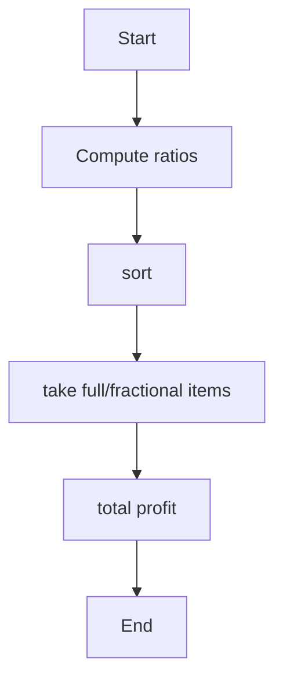
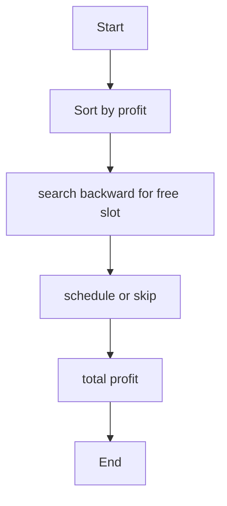
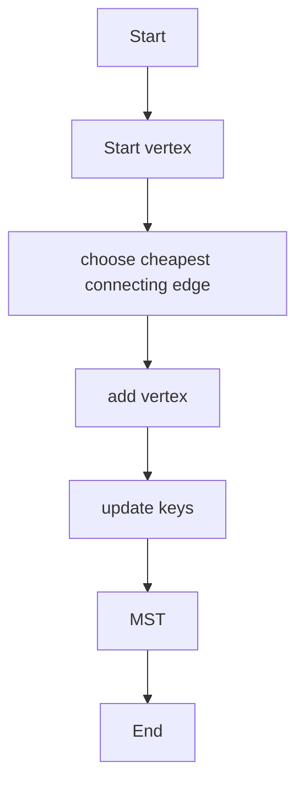
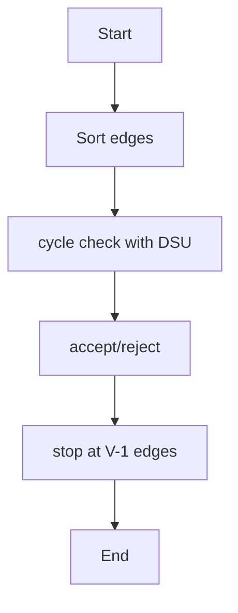

# Unit 3 — Greedy Method

For each algorithm: concept, pseudocode, algorithm-specific flowchart, and complexity.

## Fractional Knapsack

**Concept:** Sort items by value/weight and take as much as possible from the highest-ratio item first.

**Pseudocode:**
```text
sort by value/weight descending; for each item take min(1, capacity/weight) fraction
```

**Flowchart:**


**Complexity:**
- Best: `O(n log n)`
- Average: `O(n log n)`
- Worst: `O(n log n)`
- Auxiliary space: `O(n)`

**Representative output:**
```text
Maximum profit = 240.0
```


## Job Sequencing with Deadlines

**Concept:** Sort jobs by profit and place each job in the latest free slot before its deadline.

**Pseudocode:**
```text
sort jobs by profit descending; for job: find latest free slot ≤ deadline; schedule
```

**Flowchart:**


**Complexity:**
- Best: `O(n log n)`
- Average: `O(nD) after sort`
- Worst: `O(nD)`
- Auxiliary space: `O(D)`

**Representative output:**
```text
Selected jobs: J3, J1, J5 | Total profit = 142
```


## Prim's MST

**Concept:** Grow a minimum spanning tree by repeatedly adding the lowest-weight edge to an unvisited vertex.

**Pseudocode:**
```text
key[source]=0; repeat V times: u=min unvisited key; add u; relax adjacent vertices
```

**Flowchart:**


**Complexity:**
- Best: `O(V²) matrix`
- Average: `O(V²)`
- Worst: `O(V²)`
- Auxiliary space: `O(V)`

**Representative output:**
```text
MST edges: 0-1(2), 1-2(3), 1-4(5), 0-3(6) | Total = 16
```


## Kruskal's MST

**Concept:** Process edges in ascending weight and add an edge only if it does not create a cycle.

**Pseudocode:**
```text
sort edges; for edge(u,v): if find(u)!=find(v): union(u,v); add edge
```

**Flowchart:**


**Complexity:**
- Best: `O(E log E)`
- Average: `O(E log E)`
- Worst: `O(E log E)`
- Auxiliary space: `O(V)`

**Representative output:**
```text
MST weight = 16
```

> Note: Output lines and output sheets are representative references, not screenshots captured from live execution of the repository's exact source files.