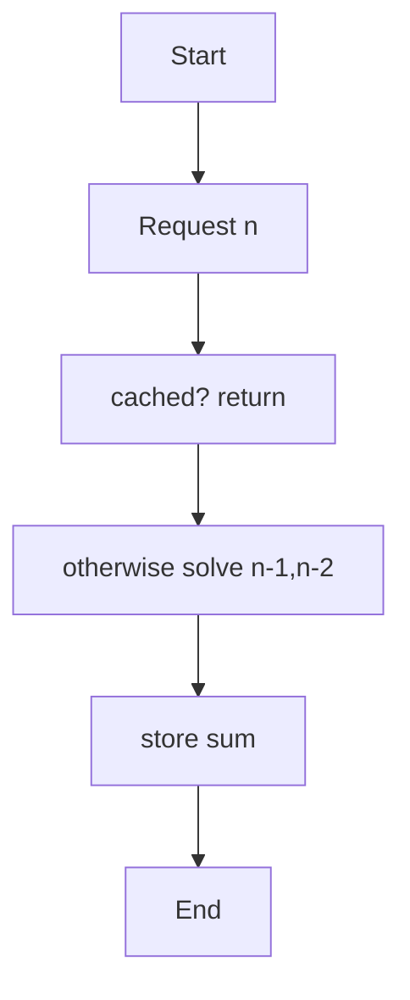
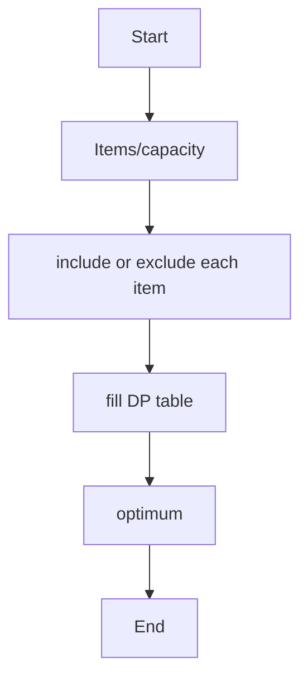
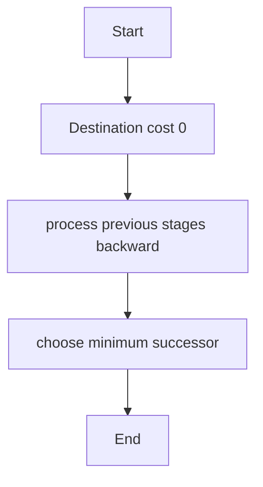
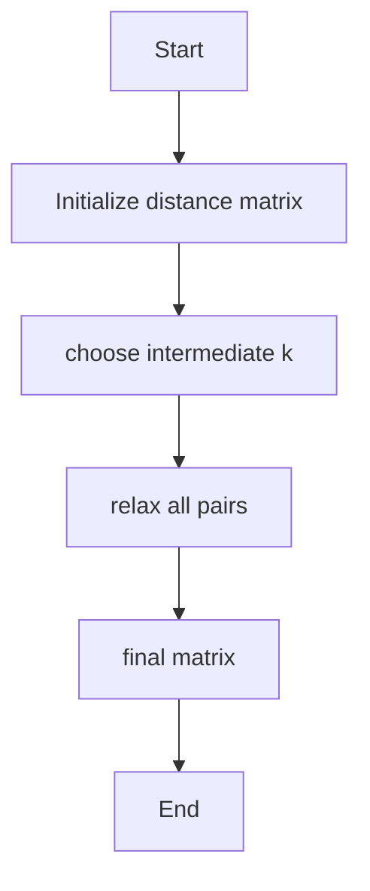
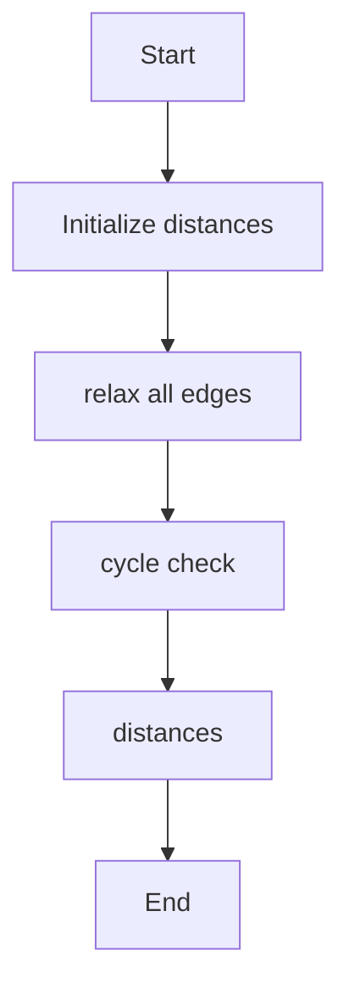
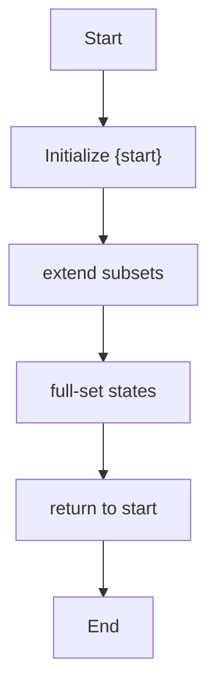

# Unit 4 — Dynamic Programming

For each algorithm: concept, pseudocode, algorithm-specific flowchart, and complexity.

## Memoized Fibonacci

**Concept:** Store solved Fibonacci values so each subproblem is computed once.

**Pseudocode:**
```text
fib(n): if n≤1 return n; if memo[n] empty memo[n]=fib(n-1)+fib(n-2); return memo[n]
```

**Flowchart:**


**Complexity:**
- Best: `O(n)`
- Average: `O(n)`
- Worst: `O(n)`
- Auxiliary space: `O(n)`

**Representative output:**
```text
Fibonacci(10) = 55
```


## 0/1 Knapsack

**Concept:** For every item and capacity, choose the better of excluding or including the item.

**Pseudocode:**
```text
dp[i][w]=max(dp[i-1][w], value[i]+dp[i-1][w-weight[i]]) when it fits
```

**Flowchart:**


**Complexity:**
- Best: `O(nW)`
- Average: `O(nW)`
- Worst: `O(nW)`
- Auxiliary space: `O(nW)`

**Representative output:**
```text
Maximum value = 9
```


## Multistage Graph

**Concept:** Compute minimum cost from each vertex to destination in reverse stage order.

**Pseudocode:**
```text
cost[destination]=0; for u in reverse order: cost[u]=min(w(u,v)+cost[v])
```

**Flowchart:**


**Complexity:**
- Best: `O(V²) matrix`
- Average: `O(V²)`
- Worst: `O(V²)`
- Auxiliary space: `O(V)`

**Representative output:**
```text
Minimum path cost = 5 | Path: 0 → 2 → 4 → 5
```


## Floyd-Warshall

**Concept:** Improve every pair's distance by considering each vertex as an intermediate point.

**Pseudocode:**
```text
for k,i,j: dist[i][j]=min(dist[i][j],dist[i][k]+dist[k][j])
```

**Flowchart:**


**Complexity:**
- Best: `O(V³)`
- Average: `O(V³)`
- Worst: `O(V³)`
- Auxiliary space: `O(V²)`

**Representative output:**
```text
All-pairs shortest-path matrix computed
```


## Bellman-Ford Shortest Path

**Concept:** Relax all edges V-1 times, then check for a reachable negative-weight cycle.

**Pseudocode:**
```text
dist[src]=0; repeat V-1: relax each edge; one more pass detects negative cycle
```

**Flowchart:**


**Complexity:**
- Best: `O(E) early stop`
- Average: `O(VE)`
- Worst: `O(VE)`
- Auxiliary space: `O(V)`

**Representative output:**
```text
Distances from 0: [0, 2, 7, 4, -2]
```


## TSP — Held-Karp DP

**Concept:** Use a bitmask to represent visited cities and store the cheapest path ending at each city.

**Pseudocode:**
```text
dp[mask][v]=min(dp[mask without v][u]+cost[u][v]); close tour to start
```

**Flowchart:**


**Complexity:**
- Best: `O(n²2ⁿ)`
- Average: `O(n²2ⁿ)`
- Worst: `O(n²2ⁿ)`
- Auxiliary space: `O(n2ⁿ)`

**Representative output:**
```text
Minimum TSP tour cost = 80
```

> Note: Output lines and output sheets are representative references, not screenshots captured from live execution of the repository's exact source files.