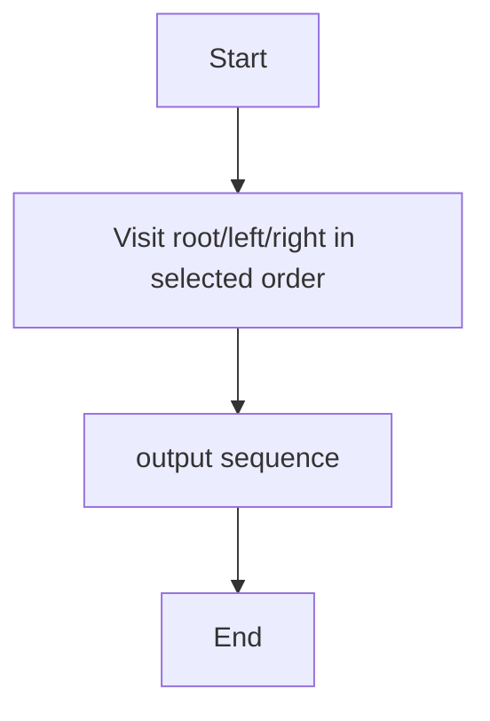
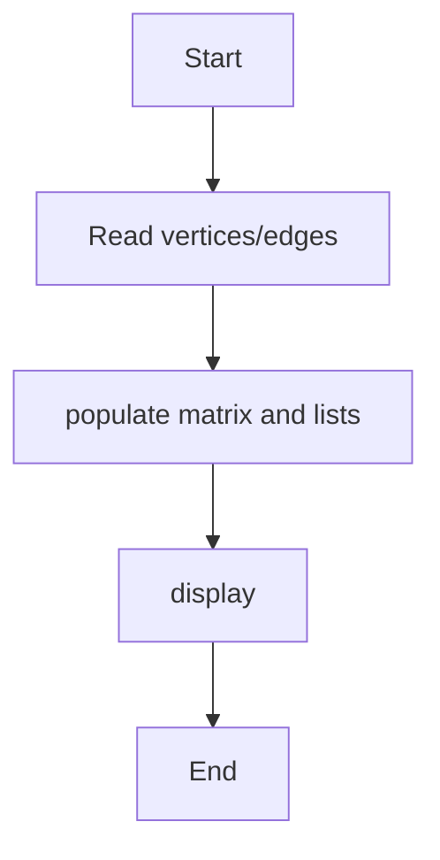
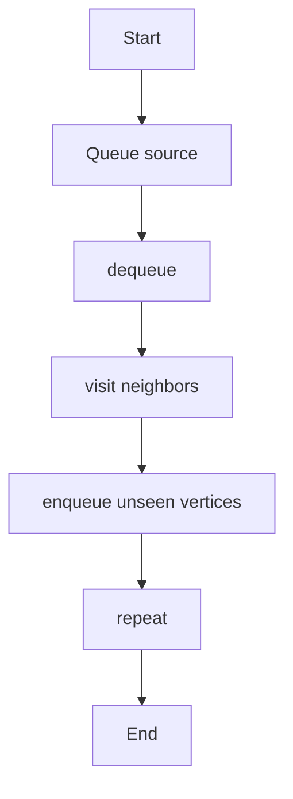
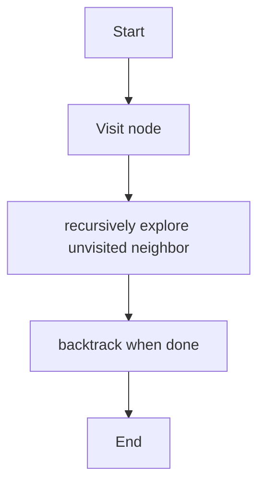

# Unit 5 — Traversal and Search

For each algorithm: concept, pseudocode, algorithm-specific flowchart, and complexity.

## Binary Tree Traversals

**Concept:** Visit every node in a specific order: preorder, inorder, or postorder.

**Pseudocode:**
```text
preorder: root,left,right; inorder: left,root,right; postorder: left,right,root
```

**Flowchart:**


**Complexity:**
- Best: `O(n)`
- Average: `O(n)`
- Worst: `O(n)`
- Auxiliary space: `O(h) recursion stack`

**Representative output:**
```text
Preorder: 1 2 4 5 3 6 7 | Inorder: 4 2 5 1 6 3 7 | Postorder: 4 5 2 6 7 3 1
```


## Graph Representation

**Concept:** Represent graph connections using an adjacency matrix or adjacency list.

**Pseudocode:**
```text
for each edge(u,v): matrix[u][v]=1; list[u].add(v)
```

**Flowchart:**


**Complexity:**
- Best: `O(V+E) list construction`
- Average: `O(V+E)`
- Worst: `O(V²) matrix`
- Auxiliary space: `O(V²) matrix; O(V+E) list`

**Representative output:**
```text
Adjacency list: 0→[1,2], 1→[0,3,4], 2→[0,4], 3→[1], 4→[1,2]
```


## BFS

**Concept:** Explore a graph level by level using a queue.

**Pseudocode:**
```text
mark source; enqueue; while queue not empty: dequeue u; visit/enqueue unvisited neighbors
```

**Flowchart:**


**Complexity:**
- Best: `O(V+E)`
- Average: `O(V+E)`
- Worst: `O(V+E)`
- Auxiliary space: `O(V)`

**Representative output:**
```text
BFS traversal: 0 1 2 3 4 5
```


## DFS

**Concept:** Explore as far as possible along a branch before backtracking.

**Pseudocode:**
```text
dfs(u): visited[u]=true; for v in adj[u]: if not visited[v] dfs(v)
```

**Flowchart:**


**Complexity:**
- Best: `O(V+E)`
- Average: `O(V+E)`
- Worst: `O(V+E)`
- Auxiliary space: `O(V)`

**Representative output:**
```text
DFS traversal: 0 1 3 5 4 2
```

> Note: Output lines and output sheets are representative references, not screenshots captured from live execution of the repository's exact source files.