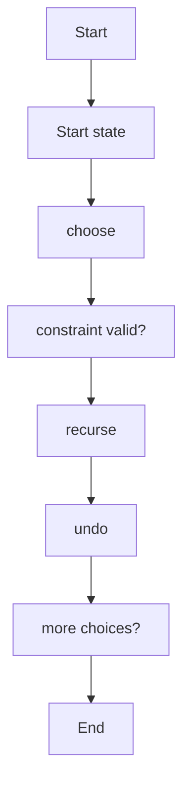
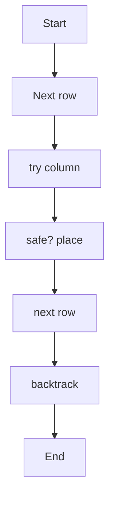
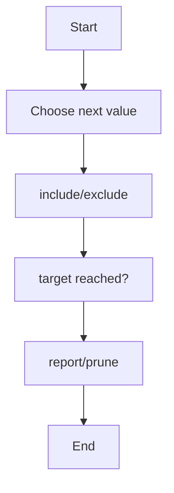
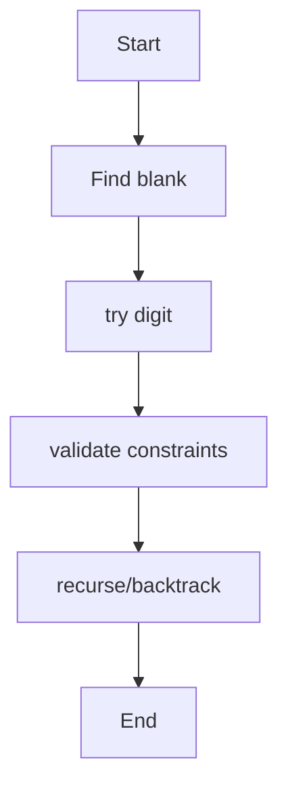
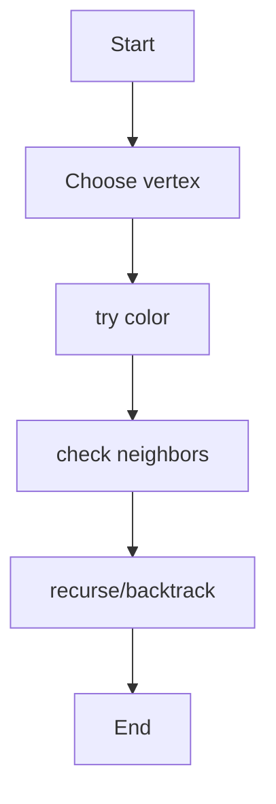

# Unit 6 — Backtracking

For each algorithm: concept, pseudocode, algorithm-specific flowchart, and complexity.

## General Backtracking

**Concept:** Build a candidate solution incrementally; reject invalid partial candidates and undo choices.

**Pseudocode:**
```text
backtrack(state): if complete report; for choice: if valid apply; recurse; undo
```

**Flowchart:**


**Complexity:**
- Best: `Exponential, problem-dependent`
- Average: `Exponential`
- Worst: `Exponential`
- Auxiliary space: `O(depth) recursion`

**Representative output:**
```text
Search stops exploring a branch as soon as a constraint is violated
```


## N-Queens (4/8/N)

**Concept:** Place one queen per row while ensuring no shared column or diagonal.

**Pseudocode:**
```text
place(row): if row==N count; for col: if safe place; recurse(row+1); remove
```

**Flowchart:**


**Complexity:**
- Best: `Exponential`
- Average: `O(N!) upper bound with row-wise pruning`
- Worst: `O(N!)`
- Auxiliary space: `O(N)`

**Representative output:**
```text
4-Queens: 2 solutions | 8-Queens: 92 solutions
```


## Sum of Subsets

**Concept:** Explore include/exclude decisions for each element, pruning sums above target when values are positive.

**Pseudocode:**
```text
search(i,sum): if sum==target report; if i==n or sum>target return; include; exclude
```

**Flowchart:**


**Complexity:**
- Best: `O(2ⁿ)`
- Average: `O(2ⁿ)`
- Worst: `O(2ⁿ)`
- Auxiliary space: `O(n)`

**Representative output:**
```text
Example target 30: [5,10,15], [5,12,13], [12,18]
```


## Sudoku Solver

**Concept:** Fill empty cells with digits 1–9 while respecting row, column, and box constraints.

**Pseudocode:**
```text
find empty; for digit 1..9: if safe place; recurse; undo on failure
```

**Flowchart:**


**Complexity:**
- Best: `Exponential worst case`
- Average: `Exponential`
- Worst: `O(9^(empty cells))`
- Auxiliary space: `O(81) plus recursion`

**Representative output:**
```text
Sample Sudoku solved successfully
```


## Graph Coloring

**Concept:** Assign one of m colors to each vertex so adjacent vertices differ.

**Pseudocode:**
```text
color(v): for c=1..m: if safe assign; recurse(v+1); undo
```

**Flowchart:**


**Complexity:**
- Best: `O(m^V)`
- Average: `O(m^V)`
- Worst: `O(m^V)`
- Auxiliary space: `O(V)`

**Representative output:**
```text
Example graph colored with 3 colors: [1,2,3,2]
```

> Note: Output lines and output sheets are representative references, not screenshots captured from live execution of the repository's exact source files.