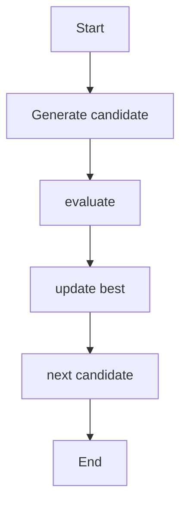
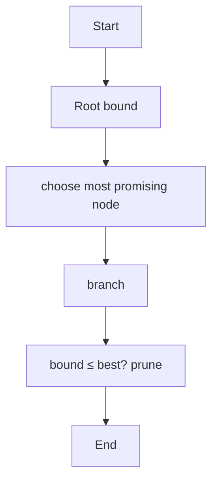
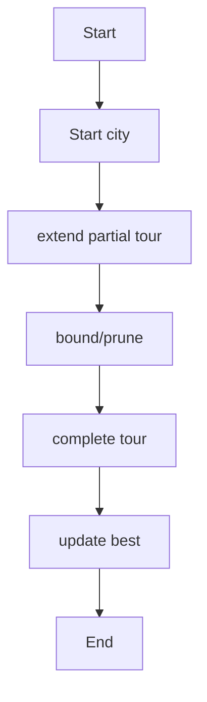
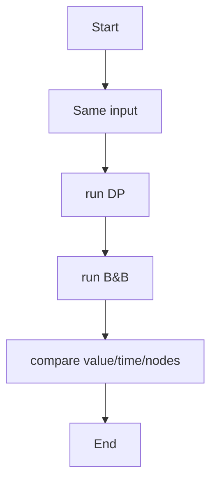
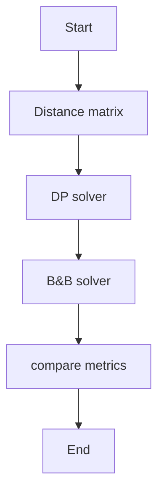
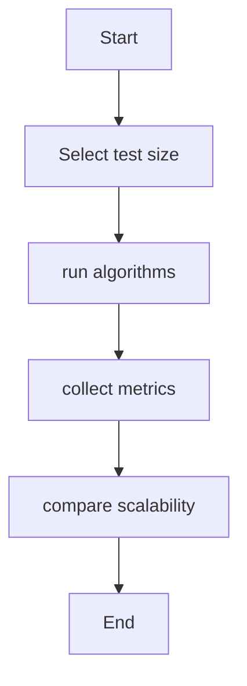

# Unit 7 — NP-Hard, NP-Complete and Optimization

For each algorithm: concept, pseudocode, algorithm-specific flowchart, and complexity.

## Exhaustive Search

**Concept:** Enumerate every candidate solution and test whether it satisfies the problem.

**Pseudocode:**
```text
for each candidate in solution space: evaluate; keep best/valid candidate
```

**Flowchart:**


**Complexity:**
- Best: `O(2ⁿ) subset search`
- Average: `O(2ⁿ)`
- Worst: `O(2ⁿ)`
- Auxiliary space: `O(n) recursive`

**Representative output:**
```text
Subset-sum example: target 10 → pair (4,6) found
```


## 0/1 Knapsack — Branch and Bound

**Concept:** Explore include/exclude choices in order of optimistic fractional upper bound; prune nodes that cannot beat current best.

**Pseudocode:**
```text
compute bound(node); expand include/exclude children; keep promising nodes
```

**Flowchart:**


**Complexity:**
- Best: `Pruning-dependent`
- Average: `Exponential`
- Worst: `O(2ⁿ)`
- Auxiliary space: `O(2ⁿ) priority queue worst case`

**Representative output:**
```text
Optimal value = 150 (sample instance)
```


## TSP — Branch and Bound

**Concept:** Explore partial tours and prune any partial route whose cost cannot beat the best complete tour.

**Pseudocode:**
```text
DFS/priority queue partial tours; if partialCost≥best prune; extend unvisited city
```

**Flowchart:**


**Complexity:**
- Best: `Pruning-dependent`
- Average: `Exponential`
- Worst: `O(n!)`
- Auxiliary space: `O(n!) worst case`

**Representative output:**
```text
Minimum tour cost = 80 (sample instance)
```


## DP vs Branch and Bound — Knapsack

**Concept:** Compare exact dynamic programming table against branch-and-bound search using the same item set.

**Pseudocode:**
```text
run DP; run B&B; record optimum, time, explored nodes
```

**Flowchart:**


**Complexity:**
- Best: `DP O(nW)`
- Average: `DP O(nW); B&B exponential worst case`
- Worst: `DP O(nW); B&B exponential`
- Auxiliary space: `DP O(nW); B&B exponential`

**Representative output:**
```text
Both methods return the same optimal value on the sample
```


## DP vs Branch and Bound — TSP

**Concept:** Compare Held-Karp dynamic programming with branch-and-bound search on identical distance matrices.

**Pseudocode:**
```text
run Held-Karp; run B&B; compare optimal tour cost, time, explored nodes
```

**Flowchart:**


**Complexity:**
- Best: `DP O(n²2ⁿ)`
- Average: `Exponential`
- Worst: `O(n²2ⁿ) DP; O(n!) B&B`
- Auxiliary space: `O(n2ⁿ) DP; exponential B&B`

**Representative output:**
```text
Both methods return the same optimal tour cost on the sample
```


## Optimization Algorithm Comparison System

**Concept:** Benchmark optimization methods using runtime, explored states, memory, and solution quality.

**Pseudocode:**
```text
for each algorithm/input: time run; collect nodes, memory, result; compare
```

**Flowchart:**


**Complexity:**
- Best: `Depends on algorithm`
- Average: `Exponential worst case`
- Worst: `Exponential worst case`
- Auxiliary space: `Algorithm-dependent`

**Representative output:**
```text
Report includes runtime, node count, solution quality, and input size
```

> Note: Output lines and output sheets are representative references, not screenshots captured from live execution of the repository's exact source files.