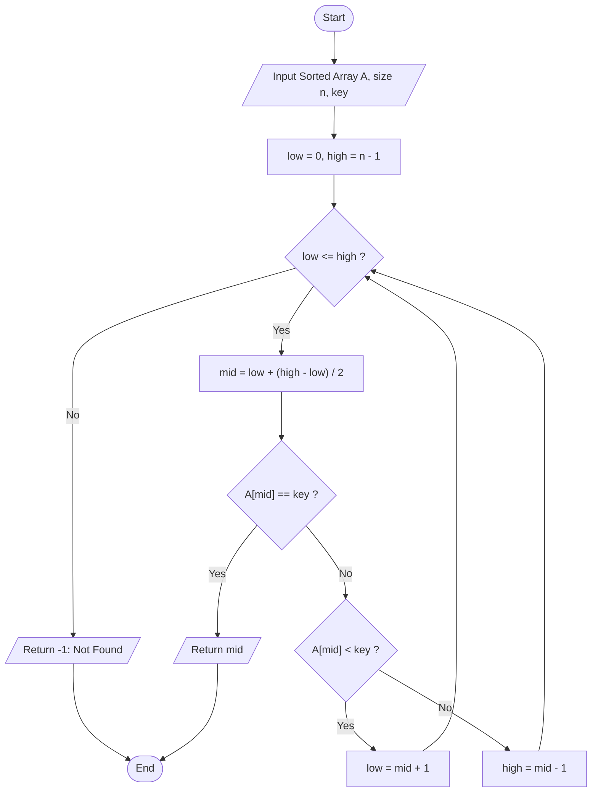

# Binary Search: Pseudocode & Flowchart

## 1. Pseudocode (Iterative Binary Search)
```text
ALGORITHM BinarySearch(A[0..n-1], key)
// Input: A sorted array A of size n, and a search element 'key'
// Output: Index of 'key' in A, or -1 if not found

low <- 0
high <- n - 1

WHILE low <= high DO
    mid <- low + (high - low) / 2
    IF A[mid] == key THEN
        RETURN mid
    ELSE IF A[mid] < key THEN
        low <- mid + 1
    ELSE
        high <- mid - 1
    END IF
END WHILE

RETURN -1
```

## 2. Flowchart

